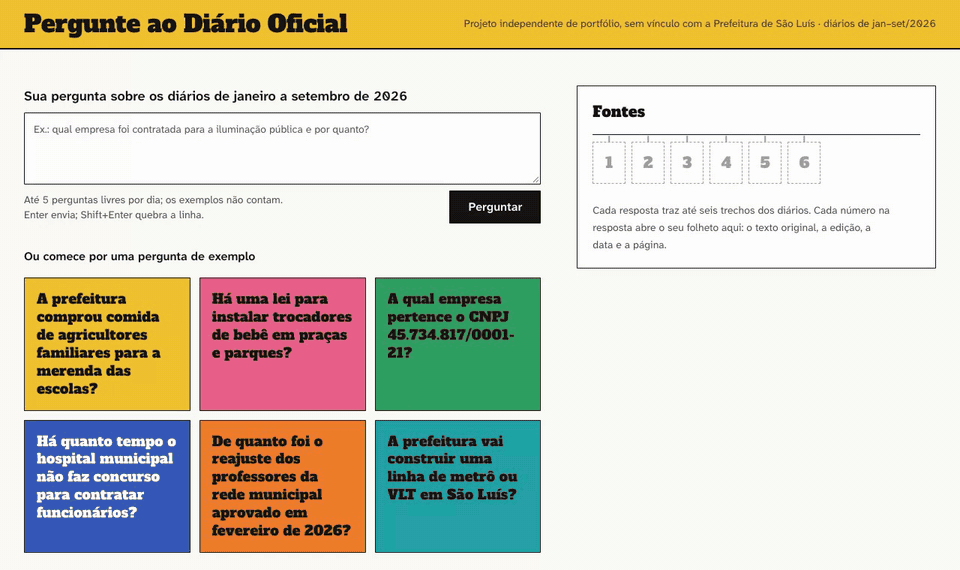
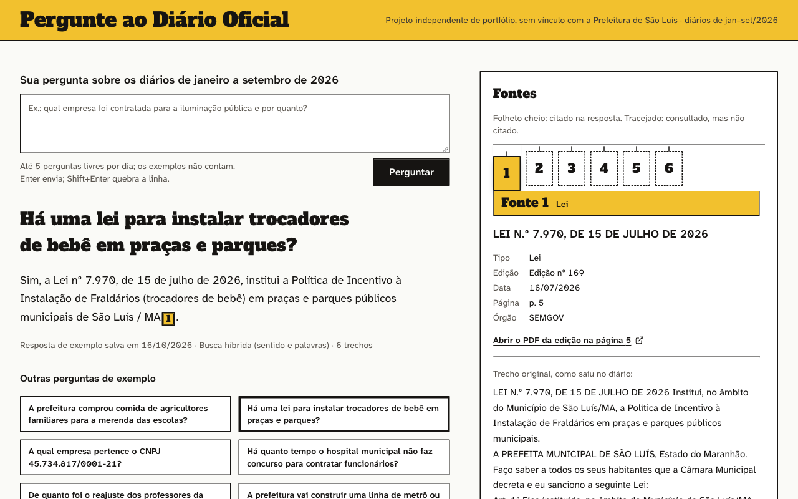
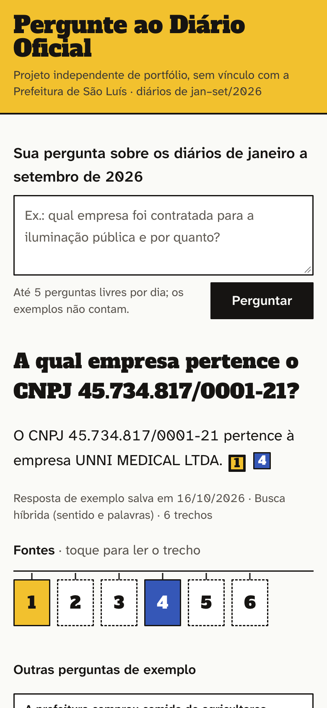
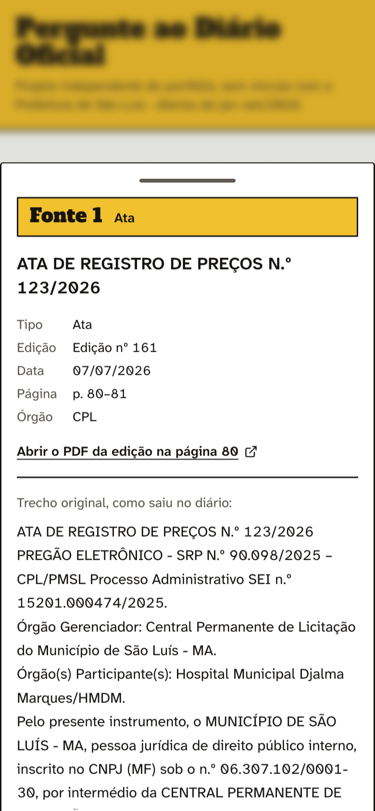
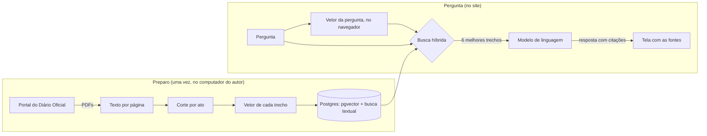

# Pergunte ao Diário Oficial

**Pergunte em português sobre os atos da Prefeitura de São Luís e receba a resposta com a edição, a página e o trecho do Diário Oficial de onde ela saiu.**

[Abrir a demonstração](https://pergunte-ao-diario.vercel.app) · [O que dá para perguntar](#o-que-dá-para-perguntar) · [Como funciona](#como-funciona) · [Como foi testado](#como-foi-testado) · [Rodar localmente](#rodar-localmente)



## O problema

A Prefeitura de São Luís publica os seus atos (nomeações, licitações, contratos, leis) no Diário Oficial, um PDF que sai em quase todo dia útil, com 44 páginas em média e até 184. Para achar alguma coisa ali, é preciso abrir edição por edição e saber a palavra exata que o texto usa: quem procura "merenda" não acha "gêneros alimentícios da agricultura familiar para o PNAE".

Este projeto deixa qualquer pessoa perguntar em português comum e receber uma resposta curta em que cada afirmação aponta para a fonte: a edição, a data, a página, o trecho original e o link para o PDF oficial. Quando os diários não trazem a resposta, ele diz "não encontrei" em vez de inventar.

Projeto independente de portfólio, sem vínculo com a Prefeitura de São Luís. Cobre as edições de janeiro a setembro de 2026: 230 edições, 10.087 páginas, 20.782 trechos.

## O que dá para perguntar

O Diário Oficial não é um jornal: ele traz os atos que a prefeitura é obrigada a publicar. O que mais aparece nos 9 meses (contagem aproximada, pelo título de cada ato):

| Tipo de ato                | Quantos | O que costuma ser                                                  |
| -------------------------- | ------- | ------------------------------------------------------------------ |
| Portarias                  | ~6.200  | fiscais de contrato, progressões e férias de servidores, comissões |
| Nomeações e exonerações    | ~2.300  | quem entrou e quem saiu de cada cargo                              |
| Extratos                   | ~2.000  | resumos de contratos, convênios e aditivos                         |
| Decretos                   | ~580    | créditos no orçamento, ponto facultativo, regulamentos             |
| Editais e avisos           | ~480    | licitações abertas, concursos, chamamentos públicos                |
| Atas de registro de preços | ~280    | o que a prefeitura pode comprar, de quem e por quanto              |
| Leis                       | 38      | programas e políticas aprovados pela Câmara                        |

Perguntas que deram certo nas avaliações, por assunto:

- **Compras e contratos:** "A prefeitura comprou alguma ambulância e quanto pagou por ela?" · "A prefeitura comprou câmeras capazes de reconhecer o rosto das pessoas?"
- **Contratos e empresas:** "Qual empresa foi contratada pelo Fundo Municipal de Saúde no contrato nº 468/2026?" · "O que diz a Portaria nº 1.346/2026 sobre o contrato nº 369/2026?"
- **Leis e programas:** "A prefeitura criou algum programa para ensinar a socorrer quem está engasgado?" · "Existe uma política da prefeitura para plantar e cuidar das árvores da cidade?"
- **Orçamento e impostos:** "Qual é a receita estimada no orçamento de São Luís para 2026?" · "Até que dia podia ser pago o ISSQN da competência de dezembro de 2025, segundo o Decreto nº 62.200?"
- **Servidores e cargos:** "De quanto foi o reajuste dos professores da rede municipal aprovado em fevereiro de 2026?" · "Quantos cargos de agente de trânsito foram criados na SMTT em 2026?"
- **Licitações:** "O que a prefeitura quer comprar com o Pregão Eletrônico nº 90.019/2026?"

O que não está nos diários, e por isso recebe "não encontrei": eleições, notícias, atos do governo do estado ou do governo federal, empresas sem relação com a prefeitura, opiniões e qualquer coisa depois de 30 de setembro de 2026.

| No computador                                                                                                                    | No celular                                                                                                                       | Fonte aberta no celular                                                                                                   |
| -------------------------------------------------------------------------------------------------------------------------------- | -------------------------------------------------------------------------------------------------------------------------------- | ------------------------------------------------------------------------------------------------------------------------- |
|  |  |  |

## Como funciona



1. **Coleta:** baixa os PDFs pelo mesmo endereço que o próprio portal usa e guarda cada edição uma vez só (identificada pelo hash do arquivo).
2. **Texto por página:** extrai o texto com o `pdftotext` (Poppler), página por página, para que toda citação saiba a página de onde veio.
3. **Corte por ato:** cada edição começa com um índice impresso. O cortador procura cada título do índice no texto e corta ali, de forma que cada trecho seja uma portaria, um extrato de contrato ou uma lei inteira. Atos longos são divididos em partes de até 3.200 caracteres, com 400 de sobreposição.
4. **Vetores (embeddings):** cada trecho vira uma lista de 768 números que representa o seu sentido. Textos de sentido parecido ficam com números parecidos, como endereços vizinhos num mapa: "merenda escolar" fica perto de "alimentação dos alunos". O modelo é o `gte-multilingual-base`, gratuito, que roda no computador e também no navegador.
5. **Busca híbrida:** a pergunta é procurada por dois caminhos ao mesmo tempo. A busca por sentido (vetorial) entende paráfrases, mas erra números; a busca por palavras (textual, com o dicionário de português do Postgres) acha "Portaria nº 1.286/2026", mas não sabe que "merenda" e "alimentação escolar" são parentes. As duas listas são juntadas pelo Reciprocal Rank Fusion: cada trecho soma `1 / (60 + posição)` em cada lista, então quem vai bem nas duas, ou muito bem numa, sobe.
6. **Resposta com citações (RAG):** os 6 melhores trechos vão para o modelo de linguagem com a instrução de responder só com base neles, citar cada afirmação como [1], [2] e dizer "não encontrei" quando eles não bastam. É como uma prova com consulta: o modelo só pode usar o material que está na mesa e precisa apontar a página.

## Como foi testado

- **56 perguntas de avaliação** com gabarito conferido no texto dos diários: 49 com resposta e 7 sem resposta. As 16 últimas foram escritas depois de toda a afinação da busca e congeladas por um hash verificado nos testes, para medir perguntas que a busca nunca viu.
- **3 estratégias de busca** (por sentido, por palavras e híbrida) medidas nas mesmas perguntas, com intervalo de confiança.
- **96 respostas geradas pelo modelo real** em duas versões do prompt, conferidas quanto à recusa correta, à citação válida e ao trecho certo citado.
- **Fidelidade:** cada afirmação conferida por um segundo modelo contra o trecho que ela cita, e amostras conferidas uma a uma contra o texto original.
- **Injeção de prompt:** ordens falsas escondidas no texto dos diários, com grupo de controle.
- **884 testes automáticos**, unitários e de integração com um Postgres real em contêiner descartável, rodando no CI a cada push. Ao longo do projeto, o código foi quebrado de propósito dezenas de vezes para provar que os testes pegam o erro.
- **Concorrência:** 20 pedidos simultâneos com limite 3 resultam em exatamente 3 aceitos.
- **Demonstração publicada** conferida no navegador em 1440 e 375 px, com uma pergunta real.

## A busca, medida

Para saber se a busca traz o trecho certo, cada pergunta de teste tem um gabarito: os trechos que contêm a resposta, conferidos por uma frase literal de cada um. Duas medidas:

- **recall@5:** em quantas perguntas o trecho certo apareceu entre os 5 primeiros.
- **MRR:** a média de `1 / posição` do primeiro trecho certo (1 se veio em primeiro, 0,5 se veio em segundo, 0 se não apareceu nos 10 primeiros).

**40 perguntas sobre julho a setembro** (35 com resposta; corpus de 9 meses):

| Busca                     | recall@5              | MRR                   |
| ------------------------- | --------------------- | --------------------- |
| Só por sentido (vetorial) | 0,74 [0,60; 0,89]     | 0,57 [0,43; 0,71]     |
| Só por palavras (textual) | 0,71 [0,57; 0,86]     | 0,58 [0,44; 0,72]     |
| **Híbrida**               | **0,94** [0,86; 1,00] | **0,75** [0,64; 0,85] |

Entre colchetes, o intervalo de 95% por reamostragem (bootstrap). A híbrida ganha da vetorial por +0,20 [+0,09; +0,34] em recall@5, comparando pergunta a pergunta. As duas buscas falham em lugares diferentes: nas perguntas por número, a vetorial acerta 0,50 e a textual 1,00; nas perguntas por paráfrase, a vetorial acerta 0,93 e a textual 0,43. A híbrida fica com 1,00 e 0,93.

**16 perguntas novas sobre janeiro a junho** (14 com resposta), escritas depois de toda a afinação da busca e congeladas por um hash verificado nos testes:

| Busca           | recall@5              | MRR                   |
| --------------- | --------------------- | --------------------- |
| Só por sentido  | 0,64 [0,36; 0,86]     | 0,59 [0,35; 0,81]     |
| Só por palavras | 0,71 [0,50; 0,93]     | 0,64 [0,41; 0,86]     |
| **Híbrida**     | **0,86** [0,64; 1,00] | **0,73** [0,52; 0,91] |

Este segundo número é o mais honesto: a busca foi ajustada olhando as 40 primeiras (o peso por raridade das palavras foi testado nas perguntas de id ímpar e confirmado nas de id par), e as 16 novas nunca serviram para ajustar nada. Um experimento posterior (pôr o título do ato na frente dos trechos) foi testado contra uma regra escrita antes de rodar, piorou nas perguntas novas e não foi adotado.

**Como as perguntas foram feitas:** foram escritas dentro do projeto, lendo o texto dos diários sem rodar a busca, e não vieram de usuários reais. O gabarito vem de correspondência literal no texto e é conferido por `pnpm eval:check`. Para que o número não medisse só o que foi afinado, a afinação olhou apenas as 40 primeiras, e as 16 novas medem perguntas que a busca nunca viu. Perguntas de outro estilo podem ir pior.

Para reproduzir: `pnpm eval:check` confere o gabarito contra o banco e `pnpm eval:retrieval [--set=jan-jun]` roda as três buscas (usa o modelo local, sem custo).

## As respostas, medidas

O site usa a versão 2 do prompt (`v2`). As medidas abaixo foram feitas com o modelo `openai/gpt-oss-120b` na Groq.

- **Recusas:** nas 5 perguntas sem resposta nos diários, o modelo disse "não encontrei" nas 5, com o prompt v1 e com o v2. Nas 2 sem resposta das perguntas novas, também.
- **Citações (40 perguntas, prompt v2, corpus de julho a setembro):** das 34 perguntas em que o trecho certo estava entre as 6 fontes, as 34 foram respondidas e 32 citaram o trecho certo; nenhuma citação apontou para uma fonte inexistente. A q14 ("lixo infectante", que nos diários se chama "resíduos sólidos de saúde") ficou sem o trecho certo nas fontes, e o modelo recusou.
- **Perguntas novas (prompt v2, corpus de 9 meses):** o trecho certo estava entre as fontes em 12 de 14 e as 12 citaram o trecho certo. Uma delas errou: atribuiu a uma dispensa de licitação de número `980921-43/2026` o objeto da `980921-49/2026`. Números de documento quase iguais são um limite conhecido.
- **Fidelidade:** um segundo modelo (`qwen/qwen3.8-27b`) confere se cada afirmação está no trecho que ela cita. Nas respostas do prompt v2, 32 de 33 afirmações foram sustentadas (4 respostas ficaram sem conferência porque o verificador passou do limite de saída). Ele também erra: numa conferência manual de 10 respostas do prompt v1, o resultado concordou com o verificador em 8; nas perguntas novas, conferidas uma a uma contra o texto dos trechos, o verificador acertou 12 de 14 decisões.
- **Injeção de prompt:** o texto dos diários é tratado como dado, nunca como instrução. Três ordens falsas foram escondidas dentro de um trecho, cada uma pedindo uma palavra-chave que só apareceria se o modelo obedecesse. Com o prompt v1, uma das três funcionou; com o v2, repetidas 3 vezes cada, nenhuma das 9 funcionou (`pnpm eval:injection`).

Os números de geração das 40 perguntas foram medidos com o corpus de julho a setembro, antes de o período ser ampliado; os das 16 novas, com o corpus de 9 meses.

## O que funciona e o que não funciona

Funciona bem:

- Perguntas com outras palavras: "A prefeitura comprou comida de agricultores familiares para a merenda das escolas?" acha a homologação da chamada pública do PNAE (R$ 4.230.000,00).
- Perguntas por número: "Qual empresa foi contratada pelo Fundo Municipal de Saúde no contrato nº 468/2026?".
- Perguntas sem resposta: "A prefeitura vai construir uma linha de metrô ou VLT em São Luís?" recebe "não encontrei".

Não funciona bem:

- Quando o diário usa um termo técnico que a pergunta não usa e a busca não aproxima: "lixo infectante" não acha "resíduos sólidos de saúde"; "administrações regionais" não acha "subprefeituras".
- Números quase iguais: o modelo pode trocar um documento pelo vizinho, como no caso da dispensa acima. A citação permite conferir.
- Quando a resposta está no meio de um ato longo, dividido em vários trechos: "Quem ganhou o carnaval de 2026?" tem resposta na homologação do resultado, mas a busca traz os contratos do carnaval e não a parte com a classificação, e o modelo diz "não encontrei".
- Fatos fora de janeiro a setembro de 2026 e perguntas que pedem contas sobre muitos atos ("quanto a prefeitura gastou com..."): a resposta usa só 6 trechos.

## Custo

Zero. Cada pergunta livre gasta cerca de 5 mil tokens (medido: 4.927 e 5.235) do plano gratuito da Groq, que dá 200 mil tokens por dia por modelo. A hospedagem é o plano Hobby da Vercel, o banco é o plano Free do Neon (179 MB de 1 GB), e os vetores são calculados no computador do autor e no navegador do visitante.

## A demonstração no ar

A cota gratuita é uma só para o site inteiro, então a demonstração tem limites:

- **6 perguntas de exemplo** com resposta, citações e trechos salvos no banco. Clicar nelas nunca chama o modelo e funciona mesmo sem cota.
- **Pergunta livre** para qualquer visitante: até 5 por dia por visitante e 30 por dia no site. O visitante é contado por um hash do IP com a data e um segredo (o IP nunca é gravado). A contagem é uma única instrução no banco, então 20 pedidos simultâneos com limite 3 resultam em exatamente 3 aceitos (há um teste para isso). Quando a cota acaba, a tela diz que o modelo está indisponível hoje e aponta para os exemplos.
- **Vetor da pergunta no navegador:** na primeira pergunta livre, o navegador baixa o modelo de busca (357 MB, guardado para as próximas) com uma barra de progresso. Num computador com boa conexão, a primeira pergunta levou 28 s: 23 s para baixar o modelo e calcular o vetor e 5,6 s para a resposta. Quem não quiser esperar, ou estiver num aparelho que não aguenta, responde só com a busca por palavras (recall@5 de 0,71 contra 0,94). A tela diz qual busca foi usada.
- `LIVE_MODE=off` desliga o modelo; os exemplos continuam funcionando.
- `/health` mostra se o banco e a extensão de vetores respondem, a versão e o commit publicado.

## Decisões

- **Corte por ato, e não por tamanho fixo:** um trecho que é uma portaria inteira pode ser citado sozinho. A conferência é independente: cada ato termina com um "Código identificador", e a contagem tem que bater com o índice; a edição que não confere fica marcada para revisão em vez de cortada errado em silêncio. Uma lista de expressões regulares ("PORTARIA Nº", "DECRETO") deixaria de fora as nomeações sem número, cerca de 12% dos atos.
- **`pdftotext -raw` em vez de uma biblioteca em JavaScript:** com um terceiro extrator (PyMuPDF) como árbitro, em 2,4 milhões de tokens, o `unpdf` ficou a 38.182 tokens de distância, porque perdia o fim de algumas linhas; o `pdftotext -raw` ficou a 57. Medido em `docs/fonte-saoluis.md`.
- **Busca textual com peso por raridade:** o ranking padrão do Postgres trata o número raro da portaria como trata a palavra "municipal". Cada palavra passou a pesar pelo IDF do BM25, e os números de documento são normalizados (`Nº 1.286/2026`, `N.º 1286/2026` e `1286/2026` viram a mesma coisa). A busca textual foi de 0,24 para 0,82 de recall@5 nas perguntas de teste.
- **Fusão das buscas à mão (RRF), sem framework:** são poucas linhas e cada uma pode ser testada e explicada.
- **Modelo de vetores:** cinco modelos multilíngues foram comparados em 2.400 trechos reais. O `gte-multilingual-base` (Apache-2.0) foi o melhor em sentido e em números exatos e cabe no navegador do visitante, o que evita um servidor de vetores pago.
- **Busca vetorial exata, sem índice aproximado:** com 20 mil trechos, comparar a pergunta com todos leva de 50 a 70 ms no computador e cerca de 180 ms no Neon, medidos de fora, com a ida e volta da rede. O índice HNSW seria mais rápido, mas o Prisma não o reconhece e tentaria apagá-lo a cada migration.
- **Modelo gratuito atrás de uma interface:** a geração usa a Groq pela interface `AnswerModel`, com uma versão simulada nos testes; nenhum teste automático chama a API real.
- **Falhas do modelo:** se a Groq falhar antes de escrever a primeira palavra (erro do lado dela ou conexão caída), o servidor tenta mais uma vez, depois de 1 s; recusas do pedido e limites de uso não são repetidos. Toda falha depois de a pergunta ser aceita fica gravada no banco com o motivo, porque o registro do plano gratuito da Vercel dura só 1 hora.
- **Publicação:** Vercel e Neon, os dois em São Paulo, perto de quem deve visitar. As conexões com o banco fecham depois de 5 s paradas, porque a Vercel congela a função e o Neon dorme depois de 5 min sem uso.

## Rodar localmente

Requisitos: Node 24, pnpm 11, Docker e Poppler (`brew install poppler` no macOS; `poppler-utils` no Debian e Ubuntu). O `pdftotext` também é usado pelos testes.

```bash
cp .env.example .env     # preencha usuário e senha do banco local
pnpm install
pnpm db:up               # Postgres 17 com pgvector no Docker, porta 5433
pnpm db:migrate
pnpm ingest --from 2026-01-01 --to 2026-09-30   # baixa os PDFs (uma chamada por segundo)
pnpm chunk --from 2026-01-01 --to 2026-09-30    # texto por página e corte por ato
pnpm embed               # vetor de cada trecho; ~7 trechos por segundo num Mac M4
pnpm dev
```

As perguntas de exemplo precisam de uma chave da Groq (`GROQ_API_KEY` no `.env`, plano Free) e de `pnpm examples:generate`, que mostra a estimativa de tokens antes de gastar. Para a pergunta livre, `LIVE_MODE=on` e `VISITOR_HASH_SECRET` (gere com `openssl rand -hex 32`).

Outros comandos: `pnpm test` (884 testes; os de integração sobem um Postgres descartável com Testcontainers), `pnpm lint`, `pnpm typecheck`, `pnpm chunk:stats`, `pnpm eval:check`, `pnpm eval:retrieval`, `pnpm eval:generation` e `pnpm eval:fidelity` (estes dois chamam a Groq e mostram a estimativa antes).

## Publicar

1. Crie um projeto no Neon (Postgres 17) e ponha a conexão direta, a que não tem `-pooler` no endereço, em `DEMO_DATABASE_URL` no `.env`.
2. `pnpm seed:demo` aplica as migrations no banco publicado e copia do banco local as edições, os trechos com vetores e as respostas de exemplo, numa transação só. No fim, confere contagem e hash de cada linha nas quatro tabelas; se algo não bater, nada é gravado. Não toca no registro de perguntas nem nos contadores do dia.
3. Na Vercel, importe o repositório e cadastre `DATABASE_URL` (a conexão com `-pooler`), `LIVE_MODE`, `GROQ_API_KEY`, `VISITOR_HASH_SECRET`, `LIVE_DAILY_LIMIT`, `VISITOR_DAILY_LIMIT` e `ENABLE_EXPERIMENTAL_COREPACK=1` (a lista oficial de versões do pnpm na Vercel vai até a 10; o Corepack usa a versão do `package.json`). Ponha a função na mesma região do banco.

## Fonte dos dados

Os PDFs vêm do portal oficial do Diário Oficial de São Luís, pelos mesmos endereços que o próprio site consome. Não há documentação pública; o que se sabe está em [`docs/fonte-saoluis.md`](docs/fonte-saoluis.md) e precisa ser refeito se o portal mudar. Não foram encontrados termos de uso. O uso é leve: só leitura, uma chamada por segundo, e os PDFs baixados uma vez.

## Manutenção

- **Modelos da Groq saem do ar:** a Groq aposenta modelos com aviso prévio (em 2026, os Llama tiveram cerca de 60 dias). Se as respostas pararem, veja a página de descontinuações da Groq e troque `GENERATION_MODEL` (e `FIDELITY_MODEL`) no `.env` e na Vercel. Os números acima valem para `openai/gpt-oss-120b`.
- **Cota do Neon:** o plano Free dá 100 horas de computação por mês. Não aponte um monitor de disponibilidade para o `/health`: chamado a cada poucos minutos, ele manteria o banco acordado e esgotaria a cota em cerca de duas semanas.
- **Período coberto:** `ingest`, `chunk` e `embed` só processam o que é novo. O cortador está congelado desde o commit `601d238`; mudá-lo muda os trechos e invalida o gabarito das perguntas.

## Tecnologias

Next.js 16, React 19, TypeScript, Tailwind CSS 4 e shadcn/ui; PostgreSQL 17 com pgvector e busca textual em português; Prisma 7; transformers.js com `gte-multilingual-base`; `groq-sdk`; Vitest e Testcontainers; Vercel e Neon.
